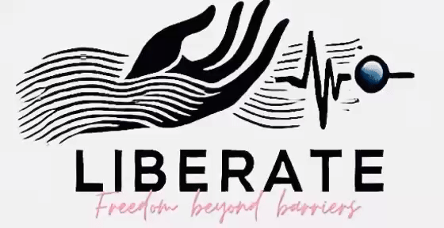

<p align="center">
  
</p>

# **Liberate : ATCS - Sistema Adaptativo de Escritura y Control**  
### *Libertad más allá de las barreras*  

[](https://github.com/aaromalonline/liberate)
[](https://www.linkedin.com/in/aaromalonline/)
[](https://github.com/aaromalonline/liberate)
<a href="https://github.com/aaromalonline/liberate/blob/master/LICENSE"></a>

**Liberate:ATCS** es un sistema de control/comunicación basado en contracciones musculares que traduce movimientos musculares sutiles en señales de control a través de una interfaz de escritura adaptativa. Al detectar ligera actividad muscular facial o corporal, permite a los usuarios operar dispositivos como el cursor de una computadora, una silla de ruedas o un teclado. Esta solución innovadora y manos libres mejora la accesibilidad y la comunicación para personas con movilidad limitada, cerrando la brecha entre las limitaciones físicas y la interacción digital. Diseñado para una respuesta en tiempo real y facilidad de uso, Liberate: ATCS ofrece una alternativa intuitiva y eficiente para el control asistivo.

**Nuestra Visión :** Romper barreras en la accesibilidad digital redefiniendo cómo las personas con movilidad limitada se comunican y controlan la tecnología.

***[Visitar liberate](https://www.liberate-atcs.vercel.app)***
***[Ver presentación (antigua)](https://www.canva.com/design/DAGgiwwJF50/0pNmzq6Z0drq8x91x3Nejg/view)***
***[Medios en bruto (BTS)](https://drive.google.com/drive/folders/16PRz2OhJrfej7ls2uXKP3qEmI2ENrzJ9?usp=sharing)***
<a href="https://youtu.be/9NmNVjKmtew?si=ZetWL2btwo8SBQff">
  
</a>

𝒄𝒓𝒆𝒂𝒅𝒐 𝒄𝒐𝒏 ❤️ :
[](https://www.linkedin.com/in/aaromalonline/) [](https://www.linkedin.com/in/deeraj-p-menon-aa4b5231b/)

𝒊𝒏𝒔𝒑𝒊𝒓𝒂𝒅𝒐 𝒑𝒐𝒓 [Intel's ACAT](https://www.intel.com/content/www/us/en/developer/tools/open/acat/overview.html) 


## 🛠️ Tecnologías Utilizadas
- **Python** para procesamiento de señales y lógica de control
- **ESP32** para adquisición de datos del sensor vía I2C y codificación de contracciones musculares a señales de control
- **Acelerómetro Digital/Sensor de Golpe ADXL345** para registrar el movimiento muscular utilizando aceleraciones de 3 ejes
- **Sensor infrarrojo TCRT5000** otro módulo de entrada para registrar contracciones musculares utilizando variaciones infrarrojas

## 🚀 Características
- **Detector/codificador de contracciones musculares** usando el acelerómetro digital ADXL345, el sensor IR TCRT5000 y ESP32 para convertir las contracciones musculares en señales de control/clics
- **Teclado controlado por músculos** con modos QWERTY y Morse disponibles como aplicación de escritorio PyQt5 en Python
- **SOS incorporado y síntesis de voz** utilizando un motor de voz como gTTS
- **Un diseño minimalista y rentable** para una usabilidad en el mundo real

### 👀 Próximamente
- Sugerencias de escritura automáticas con IA e interfaz de aplicación universal 
- Más funciones de control como navegación, mensajería SOS avanzada, etc.
- Controles de movilidad para mover dispositivos como sillas de ruedas, etc.
- Integración de múltiples sensores mejorados para mayor precisión
- Minimización del hardware (vía comunicación inalámbrica con interfaz de aplicación universal)

## 💻 ¿Cómo funciona? Módulos de entrada (ADXL345 & TCRT5000 IR) -> Sistema de control (ESP32) -> Interfaz adaptativa PyQt5 (Teclado muscular usando Python)
- **Sensor + Codificador** - Cuando está encendido, los módulos de entrada como el acelerómetro ADXL345 registran las contracciones musculares como aceleraciones de 3 ejes o variaciones IR, las cuales se codifican en clics (0/1) utilizando calibración de línea base y algoritmos de filtrado como detección de bordes y filtros contra rebote (debouncing).
- **Transmisión de Datos** - Los datos se envían en serie/de forma inalámbrica vía ESP32 a la aplicación de Python usando I2C, donde el usuario puede controlar una interfaz de teclado utilizando los clics de contracción decodificados.
- **Interfaz de Teclado Adaptativa en PyQt5** - Proporciona una barra de resaltado móvil que recorre alternativamente las filas del teclado, permitiendo al usuario hacer una contracción para seleccionar una fila y otra contracción para seleccionar la tecla mediante el resaltado circular.

## 📥 Instalación y Configuración
1. Clona este repositorio:
   ```sh
   git clone https://github.com/aaromalonline/liberate-atcs.git
   cd liberate-atcs
   ```
2. Instala las dependencias:
   ```sh
   pip install -r ./src/requirements.txt
   ```
3. Adquiere/construye el hardware con el diagrama de circuito anterior y sube el código de Arduino desde ./interface/interface.ino al ESP32 y ejecuta el script principal encendiendo el interruptor de alimentación
   (Nota: apaga el botón de alimentación después del uso para garantizar una lectura fluida).
   ```sh
   python main.py
   ```

## 🤝 Soporte
¡Las contribuciones son bienvenidas! No dudes en enviar problemas o solicitudes de extracción (pull requests) para mejorar el proyecto.
⭐ apóyanos dando estrella al repositorio ⭐

## 📬 Contacto
Para cualquier consulta o colaboración, contáctanos a través de **[aaromalonline@gmail.com]**.

---

> *"Rompiendo barreras, un movimiento a la vez."*
